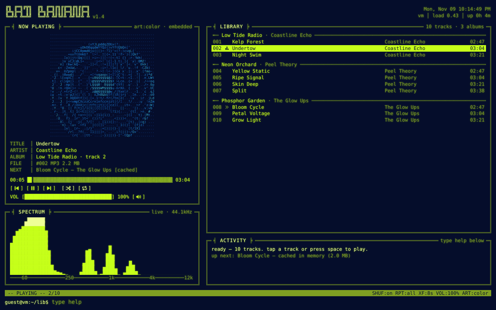
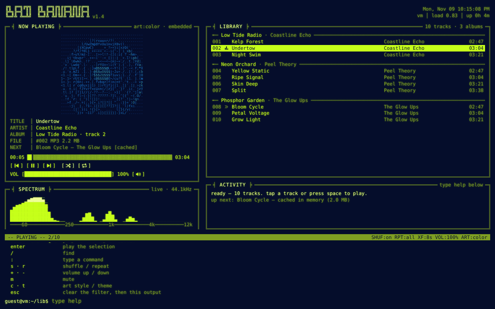
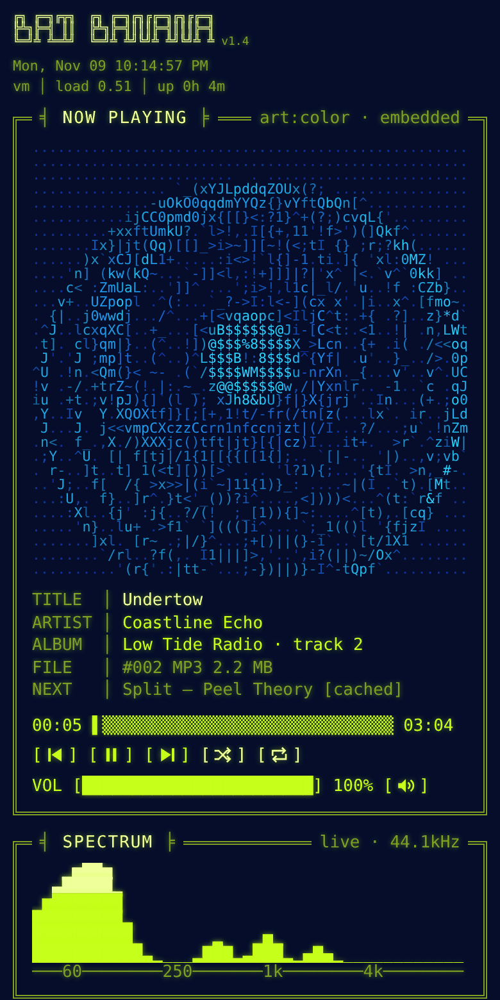
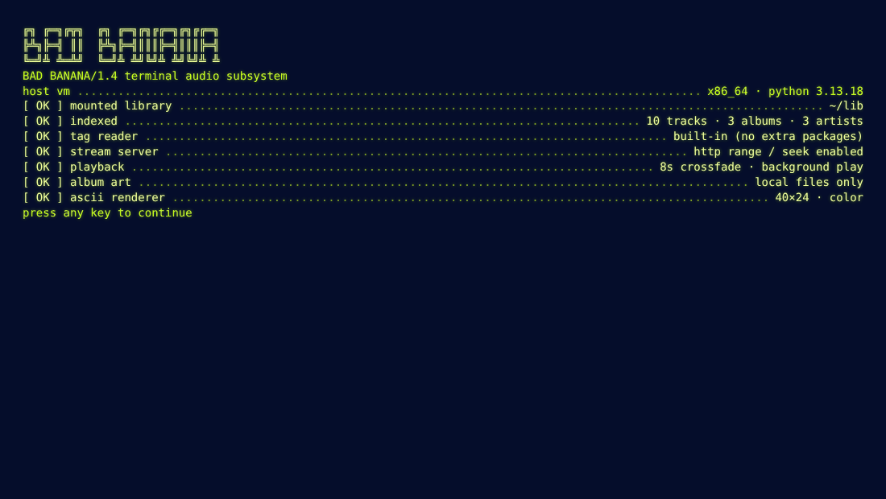
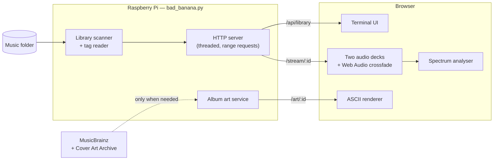
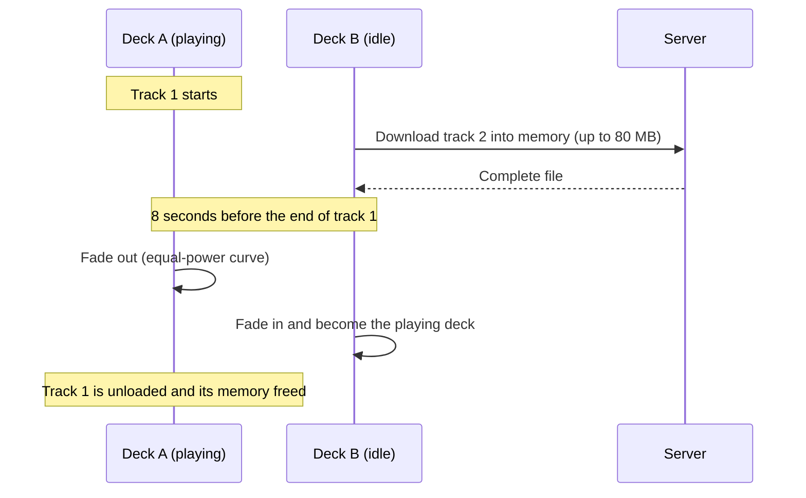

<div align="center">

<pre>
╔╗ ╔═╗╔╦╗  ╔╗ ╔═╗╔╗╔╔═╗╔╗╔╔═╗
╠╩╗╠═╣ ║║  ╠╩╗╠═╣║║║╠═╣║║║╠═╣
╚═╝╩ ╩═╩╝  ╚═╝╩ ╩╝╚╝╩ ╩╝╚╝╩ ╩
</pre>

**A retro terminal-style music streaming server for the Raspberry Pi.**<br>
One Python file. Zero dependencies. ASCII album art, a live spectrum analyser and buttery 8-second crossfades.

[](https://www.python.org/)
[](#requirements)
[](#run-it-on-boot)
[](LICENSE)
[](bad_banana.py)

[Features](#features) ·
[Quick start](#quick-start) ·
[Usage](#usage) ·
[How it works](#how-it-works) ·
[FAQ](#faq)



</div>

---

## What is Bad Banana?

Bad Banana turns a Raspberry Pi (or any computer with Python) into a **personal music streaming server**. Point it at a folder of music, open the address it prints in any browser on your network, and you get a player that looks and feels like a vintage computer terminal.

It is built for people who:

- have a **music collection on disk** (MP3, FLAC, Ogg, Opus, M4A, WAV) and want to play it from any phone, tablet or laptop at home,
- want a **fun, low-power home server project** for a spare Raspberry Pi,
- prefer **self-hosted** software with no accounts, no cloud and no tracking,
- do not want to install or maintain **any third-party packages**.

Everything, including the web interface, lives in one file: [`bad_banana.py`](bad_banana.py). It runs on the Python that already comes with Raspberry Pi OS.

<details>
<summary><strong>Table of contents</strong></summary>

- [What is Bad Banana?](#what-is-bad-banana)
- [Features](#features)
- [Screenshots](#screenshots)
- [Requirements](#requirements)
- [Quick start](#quick-start)
- [Usage](#usage)
  - [Command-line options](#command-line-options)
  - [Environment variables](#environment-variables)
  - [Examples](#examples)
- [Run it on boot](#run-it-on-boot)
- [Using the player](#using-the-player)
  - [Keyboard shortcuts](#keyboard-shortcuts)
  - [Terminal commands](#terminal-commands)
  - [Phones, lock screens and background play](#phones-lock-screens-and-background-play)
- [How it works](#how-it-works)
- [Supported formats](#supported-formats)
- [Browser support](#browser-support)
- [HTTP API](#http-api)
- [Security](#security)
- [Privacy](#privacy)
- [Troubleshooting](#troubleshooting)
- [FAQ](#faq)
- [Roadmap](#roadmap)
- [Contributing](#contributing)
- [License](#license)
- [Acknowledgements](#acknowledgements)

</details>

## Features

| Feature | Details |
|---|---|
| **Terminal interface** | Box-drawn panels, a blinking progress bar, a boot sequence and a real command prompt with history and tab completion. |
| **ASCII album art** | Cover art is converted into coloured ASCII characters live in the browser, with *color*, *blocks* and *mono* styles. |
| **Live spectrum analyser** | 60 fps bars on a musical (logarithmic) scale, smoothed so they flow, with peak markers that pop up on real peaks and fade away. |
| **Smart shuffle** | Plays every track in the library once before repeating, and keeps songs from the same album apart. |
| **Crossfade & gapless** | The next track is downloaded into memory ahead of time, then faded in over 0–12 seconds (8 by default). |
| **Lock-screen controls** | Title, artist, artwork and progress show in your phone's lock screen and your computer's media controls. Playback continues in the background. |
| **Built-in tag reader** | Reads titles, artists, albums, track numbers, durations and embedded artwork without any libraries. |
| **Online album art** | Missing covers are fetched from MusicBrainz and the Cover Art Archive, then deleted when the track finishes. |
| **Safe by default** | Strict Content Security Policy, CSRF protection, optional password and hardened file handling. |
| **Featherweight** | One file and the standard library only. The server just reads and streams files; the browser does the heavy lifting. |

## Screenshots

<table>
  <tr>
    <td width="66%"></td>
    <td width="34%" rowspan="2"></td>
  </tr>
  <tr>
    <td></td>
  </tr>
  <tr>
    <td align="center"><sub>The <code>help</code> command and the boot sequence</sub></td>
    <td align="center"><sub>The phone layout</sub></td>
  </tr>
</table>

> [!NOTE]
> The music and artwork in these screenshots are made up for the demo.

## Requirements

- **Python 3.7 or newer.** Raspberry Pi OS Buster (3.7), Bullseye (3.9) and Bookworm (3.11) all work out of the box.
- **Any operating system.** Built for Raspberry Pi OS, and also runs on other Linux distributions, macOS and Windows.
- **A modern browser** on the device you listen with. See [browser support](#browser-support).
- **No packages to install.** Nothing from `pip`, `apt` or `npm` is needed.

## Quick start

```bash
git clone https://github.com/YOUR-USERNAME/bad-banana.git
cd bad-banana
python3 bad_banana.py --music ~/Music
```

The server scans your music and prints an address:

```text
 ╔╗ ╔═╗╔╦╗  ╔╗ ╔═╗╔╗╔╔═╗╔╗╔╔═╗
 ╠╩╗╠═╣ ║║  ╠╩╗╠═╣║║║╠═╣║║║╠═╣
 ╚═╝╩ ╩═╩╝  ╚═╝╩ ╩╝╚╝╩ ╩╝╚╝╩ ╩   terminal-style music streaming for the Raspberry Pi

[8:15:02 PM] online album art: musicbrainz + cover art archive
[8:15:02 PM] scanning /home/pi/Music
[8:15:04 PM] indexed 1284 tracks in 1.9s
[8:15:04 PM] serving on http://192.168.1.42:8080
[8:15:04 PM] press ctrl+c to quit
```

Open that address on any phone, tablet or computer on the same network. Press any key or tap to get past the boot screen, then tap a track or press <kbd>Space</kbd>.

> [!TIP]
> No `git`? Download just the one file:
> ```bash
> curl -O https://raw.githubusercontent.com/YOUR-USERNAME/bad-banana/main/bad_banana.py
> ```

## Usage

```text
python3 bad_banana.py [-h] [-m MUSIC] [--host HOST] [-p PORT] [--no-online-art]
                      [--contact CONTACT] [-v] [--password PASSWORD]
```

### Command-line options

| Option | Default | Description |
|---|---|---|
| `-m`, `--music` | `~/Music` | The music folder to serve. Sub-folders are scanned too. |
| `--host` | `0.0.0.0` | The address to listen on. `0.0.0.0` means every network interface. Use `127.0.0.1` for this computer only, or `::` for IPv6. |
| `-p`, `--port` | `8080` | The port to listen on (1–65535). |
| `--no-online-art` | off | Only use artwork embedded in files or saved as images in album folders. |
| `--contact` | the project maintainer | An email address or URL sent to MusicBrainz with album art lookups, as their [API rules](https://musicbrainz.org/doc/MusicBrainz_API/Rate_Limiting) ask. **Set this to your own if you fork the project.** |
| `-v`, `--verbose` | off | Keep logging requests and album art activity after startup. Normally the console goes quiet. |
| `--password` | none | Require this password (any username) using HTTP Basic authentication. |
| `-h`, `--help` | | Show the built-in help. |

### Environment variables

Every option can also be set with an environment variable, which is handy for systemd or Docker. Command-line options win if both are given.

| Variable | Same as | Example |
|---|---|---|
| `BADBANANA_DIR` | `--music` | `/mnt/usb/Music` |
| `BADBANANA_HOST` | `--host` | `127.0.0.1` |
| `BADBANANA_PORT` | `--port` | `8000` |
| `BADBANANA_ONLINE_ART` | `--no-online-art` when set to `0`, `false`, `no` or `off` | `off` |
| `BADBANANA_CONTACT` | `--contact` | `you@example.com` |
| `BADBANANA_VERBOSE` | `--verbose` when set to anything other than `0`, `false`, `no` or `off` | `1` |
| `BADBANANA_PASSWORD` | `--password` | `correct-horse-battery-staple` |

### Examples

```bash
python3 bad_banana.py --music /mnt/usb/Music
python3 bad_banana.py --port 8000 --password "my secret"
python3 bad_banana.py --host 127.0.0.1 --no-online-art
BADBANANA_DIR=/srv/music BADBANANA_VERBOSE=1 python3 bad_banana.py
```

> [!IMPORTANT]
> Ports below 1024 (such as 80) need root on Linux. **Never run Bad Banana as root.** Use a port such as 8080 instead, or put a reverse proxy like Caddy or nginx in front of it.

## Run it on boot

The repository includes a hardened [systemd](https://systemd.io/) service, [`bad_banana.service`](bad_banana.service).

1. Copy the project to your Pi, for example to `/home/pi/bad-banana`.
2. Edit `bad_banana.service`. Change `User`, `Group` and every `/home/pi` path to match your username and music folder.
3. Install and start it:

   ```bash
   sudo cp bad_banana.service /etc/systemd/system/
   sudo systemctl daemon-reload
   sudo systemctl enable --now bad_banana
   ```

4. Check that it is running:

   ```bash
   systemctl status bad_banana
   journalctl -u bad_banana -f
   ```

> [!NOTE]
> The service makes the whole system read-only to Bad Banana and gives it a private `/tmp`. If your music lives outside your home folder, such as on a USB drive under `/mnt` or `/media`, that is fine, because the server only ever **reads** music.

## Using the player

The screen is split into panels:

- **Now playing** shows the ASCII album art, track details, a seek bar, playback buttons and volume.
- **Spectrum** shows the live frequency analyser.
- **Library** lists your music grouped by album. The playing track is marked with a bars icon and the next one with a double arrow.
- **Activity** shows what the player is doing: track changes, crossfades and caching.
- The **prompt** at the bottom accepts typed commands. Their output appears just above it.

Click or drag on the seek bar and the volume bar. Everything can also be done from the keyboard.

### Keyboard shortcuts

| Keys | Action |
|---|---|
| <kbd>Space</kbd> | Play / pause |
| <kbd>N</kbd> · <kbd>P</kbd> | Next / previous track |
| <kbd>←</kbd> · <kbd>→</kbd> | Seek back / forward 10 seconds |
| <kbd>↑</kbd> <kbd>↓</kbd> · <kbd>J</kbd> <kbd>K</kbd> | Move the selection |
| <kbd>Page Up</kbd> · <kbd>Page Down</kbd> | Move the selection by a page |
| <kbd>Home</kbd> · <kbd>End</kbd> · <kbd>G</kbd> <kbd>Shift</kbd>+<kbd>G</kbd> | Jump to the top / bottom |
| <kbd>Enter</kbd> | Play the selected track |
| <kbd>/</kbd> | Search the library |
| <kbd>:</kbd> | Type a command |
| <kbd>S</kbd> · <kbd>R</kbd> | Toggle shuffle / cycle repeat |
| <kbd>+</kbd> · <kbd>-</kbd> | Volume up / down |
| <kbd>M</kbd> | Mute |
| <kbd>C</kbd> · <kbd>T</kbd> | Cycle album art style / colour theme |
| <kbd>?</kbd> | Show help |
| <kbd>Esc</kbd> | Clear the search, then clear the command output |

When the volume bar has keyboard focus, the arrow keys, <kbd>Page Up</kbd>/<kbd>Page Down</kbd> and <kbd>Home</kbd>/<kbd>End</kbd> adjust the volume instead.

### Terminal commands

Type these at the prompt. Press <kbd>Tab</kbd> to complete a command and <kbd>↑</kbd>/<kbd>↓</kbd> to browse your history.

<details open>
<summary><strong>Playback</strong></summary>

| Command | Description |
|---|---|
| `play` | Resume playback |
| `play 12` | Play track number 12 |
| `play night bus` | Play the first track matching the words |
| `pause` · `resume` · `stop` | Pause, resume, or stop and rewind |
| `next` · `prev` | Skip forward or back |
| `seek 1:23` · `seek +10` · `seek -10` | Jump to a time, or forward / back by seconds |
| `fade 8` | Crossfade length in seconds, from `0` (off) to `12` |

</details>

<details open>
<summary><strong>Library</strong></summary>

| Command | Description |
|---|---|
| `find <words>` or `/words` | Filter the library. Aliases: `search`, `grep` |
| `clear` | Remove the filter |
| `albums` | List albums. Alias: `ls` |
| `album 3` | Show album number 3 from that list |
| `rescan` | Re-index the music folder after adding files |

</details>

<details open>
<summary><strong>Sound and look</strong></summary>

| Command | Description |
|---|---|
| `vol 75` | Set the volume (0–100). Alias: `volume` |
| `shuffle` · `shuffle on` · `shuffle off` | Toggle or set shuffle |
| `repeat` · `repeat off` · `repeat all` · `repeat one` | Cycle or set the repeat mode |
| `art` · `art color` · `art blocks` · `art mono` | Album art style |
| `theme` · `theme hyper` · `theme green` · `theme amber` · `theme ice` | Colour scheme |
| `viz on` · `viz off` | Spectrum analyser |

</details>

<details open>
<summary><strong>System</strong></summary>

| Command | Description |
|---|---|
| `sys` | Raspberry Pi vitals: CPU temperature, load, uptime, disk space and library size |
| `cls` | Clear the command output. Alias: `clr` |
| `help` | Show all commands and keys. Aliases: `?`, `h` |

</details>

Your volume, shuffle, repeat, crossfade, art style, theme and last played position are remembered in your browser.

### Phones, lock screens and background play

Bad Banana uses the browser's [Media Session API](https://developer.mozilla.org/docs/Web/API/Media_Session_API), so:

- the track title, artist, album, artwork and progress appear on your **lock screen**, in the **control centre**, and in desktop media overlays,
- hardware **media keys**, headphone buttons and lock-screen buttons control playback,
- music keeps playing when you **switch apps or lock the screen**.

> [!WARNING]
> iPhones and iPads do not let web pages change the volume, so on iOS the volume bar is replaced by a reminder to use your device's buttons, and crossfades become gapless track changes. Mute still works.

## How it works



<details>
<summary><strong>The library scanner and tag reader</strong></summary>

When the server starts, or when you type `rescan`, it walks the music folder (following symbolic links safely and skipping hidden files) and reads each file's tags with its own built-in parsers:

- **MP3:** ID3v1, ID3v2.2, 2.3 and 2.4 (including unsynchronisation and compressed frames), with the duration taken from Xing, VBRI or the bitrate
- **FLAC:** `STREAMINFO`, Vorbis comments and `PICTURE` blocks
- **Ogg Vorbis and Opus:** comment headers, embedded art and the final granule position for the duration
- **M4A / MP4 / AAC:** `moov` atoms, iTunes-style metadata and `covr` artwork
- **WAV:** `RIFF INFO` chunks and embedded ID3 tags

Missing tags fall back to the file name (for example `03 - Artist - Title.mp3`) and the folder name. Each track gets an ID made from a hash of its path, so the browser never sees or sends real file paths.

</details>

<details>
<summary><strong>Streaming</strong></summary>

Audio is served by a threaded server built on Python's `http.server`, with full support for HTTP range requests. That lets you seek instantly and lets browsers buffer efficiently. The page and library are gzip-compressed, and the page itself is protected by a strict Content Security Policy.

</details>

<details>
<summary><strong>Crossfades and gapless playback</strong></summary>

The browser keeps two audio "decks", like a DJ:



The fade uses an equal-power curve through the Web Audio API, so the volume does not dip in the middle. Each fade is limited to a third of either track's length, so short tracks still work.

</details>

<details>
<summary><strong>Album art pipeline</strong></summary>

1. The browser asks the server for `/art/<id>`.
2. Unless online art is turned off, the server first looks the track up on MusicBrainz: the album, then the song if that fails. Results are matched carefully by artist and title, then the cover is downloaded from the Cover Art Archive.
3. If nothing is found online, the server uses artwork embedded in the file, or an image such as `cover.jpg` or `folder.png` in the album's folder.
4. The browser shrinks the image, measures the brightness of each cell and swaps it for a character, from ` .'` up to `@$`, in the original colour.
5. Downloaded covers are stored in a private temporary folder and **deleted as soon as the track finishes** (or after the track length plus 10 minutes, whichever comes first). No more than 8 are kept at once, and the folder is removed when the server stops.

Lookups follow MusicBrainz's rate limit of one request per second[^ratelimit], back off when the service is busy, and pause for 5 minutes if your network is offline.

</details>

<details>
<summary><strong>The spectrum analyser</strong></summary>

A Web Audio `AnalyserNode` provides frequency data. Each column covers an equal slice of a 40 Hz–16 kHz logarithmic scale, so it matches how we hear. The bars are averaged, blurred across neighbours, eased with a fast attack and slow release, and given a slight sway. Peak markers appear only on genuine local peaks, then fade out over 0.4 seconds.

On iOS, a silent copy of the audio feeds the analyser, because routing the real audio through Web Audio would stop it playing in the background.

</details>

<details>
<summary><strong>Shuffle</strong></summary>

Instead of picking a random track each time, Bad Banana shuffles the whole library (or the current search results) like a deck of cards. It then reorders that list so tracks from the same album are spread apart wherever possible. Every track plays once before any repeats.

</details>

## Supported formats

| Format | Extensions | Tags | Embedded art | Plays in |
|---|---|:-:|:-:|---|
| MP3 | `.mp3` | Yes | Yes | Every browser |
| AAC / ALAC | `.m4a` `.mp4` `.aac` | Yes | Yes | Every browser (ALAC: Safari only) |
| FLAC | `.flac` | Yes | Yes | Every modern browser |
| Ogg Vorbis | `.ogg` `.oga` | Yes | Yes | Chrome, Edge, Firefox; recent Safari only |
| Opus | `.opus` | Yes | Yes | Chrome, Edge, Firefox; recent Safari only |
| WAV | `.wav` | Yes | Yes | Every browser |

Folder images are recognised with the names `cover`, `folder`, `front`, `album`, `albumart`, `albumartsmall` and `artwork`, in `.jpg`, `.jpeg`, `.png`, `.webp` or `.gif` format.

> [!TIP]
> Files the browser cannot decode are skipped automatically, with a message in the Activity panel.

## Browser support

| Browser | Playback | Crossfade | Spectrum | Lock-screen controls |
|---|:-:|:-:|:-:|:-:|
| Chrome / Edge (desktop & Android) | Yes | Yes | Yes | Yes |
| Firefox (desktop & Android) | Yes | Yes | Yes | Yes |
| Safari (macOS) | Yes | Yes | Yes | Yes |
| Safari (iPhone & iPad) | Yes | Gapless only | Yes | Yes |

The page needs JavaScript, and the spectrum starts after your first tap or key press, because browsers only allow audio processing after you interact with the page.

## HTTP API

The web interface uses a small JSON API that you can also use from scripts.

| Method | Path | Description |
|---|---|---|
| `GET` | `/` | The web interface |
| `GET` | `/api/library` | Every track, plus library and server details |
| `GET` | `/api/status` | Host name, CPU temperature, load, uptime and disk space |
| `GET` | `/stream/<id>` | The audio file (supports `Range` requests) |
| `GET` | `/art/<id>` | Album art, or `204 No Content` if there is none |
| `POST` | `/api/rescan` | Re-index the music folder |
| `DELETE` | `/api/art/<id>` | Delete downloaded art for a track |

`POST` and `DELETE` requests must include the header `X-BadBanana: 1`.

```bash
curl -s http://raspberrypi.local:8080/api/library | python3 -m json.tool | head -n 20
curl -s -X POST -H "X-BadBanana: 1" http://raspberrypi.local:8080/api/rescan
```

<details>
<summary>Example <code>/api/library</code> track</summary>

```json
{
  "id": "3f9a1c0b7e21",
  "title": "Undertow",
  "artist": "Coastline Echo",
  "albumartist": "Coastline Echo",
  "album": "Low Tide Radio",
  "track": 2,
  "disc": 0,
  "duration": 184.03,
  "size": 2209671,
  "ext": "mp3",
  "art": true
}
```

</details>

## Security

> [!CAUTION]
> Bad Banana is meant for a **trusted home network**. Do not expose it directly to the internet. For remote listening, use a VPN such as [WireGuard](https://www.wireguard.com/) or [Tailscale](https://tailscale.com/), or a reverse proxy that adds HTTPS.

Built-in protections include:

- [x] A strict Content Security Policy with hash-pinned inline code, plus frame, MIME-sniffing and referrer protection
- [x] CSRF protection on every request that changes something
- [x] Optional password, checked in constant time
- [x] No path traversal: only indexed files can be streamed, by ID
- [x] Size and decompression limits in the tag reader, so malicious files cannot exhaust memory
- [x] Album art downloads only accepted from the Cover Art Archive and archive.org, including after redirects
- [x] A systemd unit with sandboxing

Found a vulnerability? Please read [SECURITY.md](SECURITY.md) and report it privately.

## Privacy

Bad Banana has no accounts, analytics or tracking. The only data that leaves your network is the **artist, album and song title** sent to MusicBrainz when it looks up album art, along with the contact set by `--contact`. Turn this off completely with `--no-online-art`.

Your settings are stored only in your own browser's local storage.

## Troubleshooting

<details>
<summary><strong>I can't open the page from my phone</strong></summary>

- Make sure the phone is on the **same Wi-Fi network** as the Pi.
- Use the exact address the server printed, including `:8080`.
- Try `http://raspberrypi.local:8080` if the printed address does not work.
- Check whether a firewall is blocking the port, for example with `sudo ufw allow 8080/tcp`.

</details>

<details>
<summary><strong>"music folder not found"</strong></summary>

Pass the full path with `--music`, for example `--music /media/pi/USB/Music`. A `~` is expanded to your home folder.

</details>

<details>
<summary><strong>"cannot listen on 0.0.0.0:8080: Address already in use"</strong></summary>

Something else is using that port, possibly another copy of Bad Banana. Pick a different one with `--port 8081`, or find the other program with `sudo lsof -i :8080`.

</details>

<details>
<summary><strong>A track shows "ERR 4: can't play"</strong></summary>

Your browser cannot decode that format. See [supported formats](#supported-formats). For example, older Safari versions cannot play Ogg or Opus, and ALAC only plays in Safari. Converting the file to MP3, AAC or FLAC fixes it.

</details>

<details>
<summary><strong>No album art appears</strong></summary>

- Check the track has its artist tagged. Online lookups are skipped for "Unknown Artist".
- Run with `--verbose` to see what the art service is doing.
- Your Pi may be offline, or MusicBrainz may not have that album. Embed artwork in the file or add a `cover.jpg` to the folder as a fallback.

</details>

<details>
<summary><strong>The spectrum says "tap anywhere to start the spectrum"</strong></summary>

Browsers only allow audio processing after you interact with the page. Tap or press any key once.

</details>

<details>
<summary><strong>New files don't show up</strong></summary>

Type `rescan` at the prompt, or restart the server. The library is not watched for changes automatically.

</details>

## FAQ

<details>
<summary><strong>Why "standard library only"?</strong></summary>

So it works on a fresh Raspberry Pi straight away, keeps working after OS upgrades, and has nothing to keep up to date. It is also a fun challenge: the MP3, FLAC, Ogg, MP4 and WAV tag readers are all written from scratch.

</details>

<details>
<summary><strong>Can several people listen at once?</strong></summary>

Yes. Each browser is its own independent player with its own queue and settings. The server streams to all of them at the same time.

</details>

<details>
<summary><strong>Does it transcode or play through the Pi's speakers?</strong></summary>

No. Files are streamed unchanged and played by the browser on the device you are using. To play through speakers attached to the Pi, open the page in a browser on the Pi itself.

</details>

<details>
<summary><strong>How big a library can it handle?</strong></summary>

Large ones. Scanning only reads the tags at the start (and for some formats the end) of each file rather than whole files, and the track list is sent to the browser compressed. Run `rescan` after adding music.

</details>

<details>
<summary><strong>Is the album art legal to use?</strong></summary>

Bad Banana only downloads covers from the Cover Art Archive, a project by MusicBrainz and the Internet Archive, for your personal viewing, and deletes them when each track finishes[^covers]. Your own embedded and folder artwork is never uploaded anywhere.

</details>

## Roadmap

- [x] ASCII album art in three styles
- [x] Crossfade, prefetching and gapless playback
- [x] Lock-screen and media-key controls
- [x] Online album art with automatic cleanup
- [x] Whole-library, album-aware shuffle
- [ ] Playlists (M3U)
- [ ] Watch the music folder for changes
- [ ] Optional HTTPS with a self-signed certificate

Have an idea? [Open a feature request](../../issues/new/choose).

## Contributing

Contributions are very welcome. Please read [CONTRIBUTING.md](CONTRIBUTING.md) first. The short version: keep it one file, standard library only, and test on a phone as well as a desktop.

## License

Bad Banana is released under the [MIT License](LICENSE). © 2026 Scott Forbes.

## Acknowledgements

- [MusicBrainz](https://musicbrainz.org/) and the [Cover Art Archive](https://coverartarchive.org/) for open music metadata and artwork
- The [Raspberry Pi Foundation](https://www.raspberrypi.org/) for tiny, wonderful computers
- Everyone who still keeps a folder full of music files

[^ratelimit]: MusicBrainz asks applications to make no more than one request per second and to identify themselves with a contact address. Bad Banana waits 1.1 seconds between requests.
[^covers]: Album covers are copyrighted by their owners. The Cover Art Archive makes them available for display; Bad Banana stores them only temporarily and never redistributes them.
